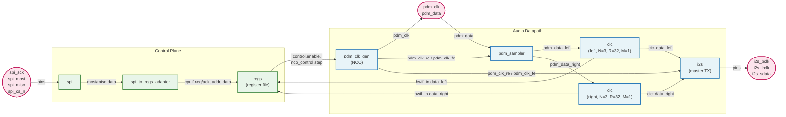

# PDM-to-PCM Audio Converter & UVM Verification Environment

An industrial-grade, parameterizable SystemVerilog implementation of a stereo PDM-to-PCM audio decimation filter designed for the TinyTapeout ASIC shuttle, verified with a complete, transaction-level Universal Verification Methodology (UVM) testbench.

---

## 1. Overview & Architectural Vision
This repository contains a silicon-ready double-channel digital MEMS microphone interface. It decimates high-frequency 1-bit Pulse Density Modulation (PDM) streams down to high-quality 8-bit multi-bit Pulse Code Modulation (PCM) packets.

* **The Design:** An optimized digital signal processing (DSP) datapath featuring Cascaded Integrator-Comb (CIC) Filters, a flexible parameterizable PDM sampling clock generator driven by a digitally controlled oscillator (NCO), and an I2S standard audio streaming interface.
* **The Verification:** An enterprise-ready SystemVerilog UVM environment leveraging Python and SystemVerilog bit-accurate reference models, complete UVM Register Abstraction Layer (RAL) via SystemRDL, and modular self-checking scoreboards targeting 100% functional correctness.

---

## 2. Verification Architecture & Block Diagram
The following block diagram outlines the verification boundary, highlighting how the UVM testbench surrounds the Device Under Test (DUT), feeds configuration registers through the UVM Register Abstraction Layer (RAL), and verifies the output stream using adaptive predictors and comparator loops:

```mermaid
flowchart TB
    %% Styling Definitions
    classDef TB fill:#f5f6f8,stroke:#1f4e79,stroke-width:2px,color:#333;
    classDef DUT fill:#e8f4f8,stroke:#2b7bba,stroke-width:2px,color:#333;
    classDef REF fill:#fff2cc,stroke:#d6b656,stroke-width:2px,color:#333;
    classDef INT fill:#fce4ec,stroke:#c2185b,stroke-width:2px,color:#333;
    classDef REG fill:#e8f5e9,stroke:#2e7d32,stroke-width:2px,color:#333;

    subgraph Testbench ["UVM Verification Testbench Environment"]
        %% Sequencers and Agents
        subgraph SPI_Agent ["SPI Master Agent"]
            SPI_Seqr["SPI Sequencer"] --> SPI_Drvr["SPI Driver"]
            SPI_Mon["SPI Monitor"]
        end
        class SPI_Agent,SPI_Seqr,SPI_Drvr,SPI_Mon TB;

        subgraph PDM_Agents ["PDM Microphone Agents"]
            subgraph Left_Mic ["Left Channel Agent"]
                PDM_Seq_L["PDM L Sequencer"] --> PDM_Drvr_L["PDM L Driver"]
            end
            subgraph Right_Mic ["Right Channel Agent"]
                PDM_Seq_R["PDM R Sequencer"] --> PDM_Drvr_R["PDM R Driver"]
            end
            PDM_Mon["PDM Passive Monitor"]
        end
        class PDM_Seq_L,PDM_Drvr_L,PDM_Seq_R,PDM_Drvr_R,PDM_Mon,Left_Mic,Right_Mic,PDM_Agents TB;

        subgraph I2S_Agent ["I2S Passive Agent"]
            I2S_Mon["I2S Monitor"]
        end
        class I2S_Agent,I2S_Mon TB;

        %% RAL model
        subgraph RegModel ["UVM RAL Block"]
            UVM_Reg["UVM Register Model"]
            Reg_Adapter["SPI RAL Adapter"]
            Reg_Predictor["SPI RAL Predictor"]
        end
        class RegModel,UVM_Reg,Reg_Adapter,Reg_Predictor REG;

        %% Scoreboard
        subgraph Scoreboard ["UVM Scoreboard"]
            Predictor_L["Predictor Left"]
            Predictor_R["Predictor Right"]
            I2S_to_PCM_Adap["I2S-to-PCM Adapter"]

            subgraph ReferenceModels ["Ref Models"]
                Ref_CIC_L["Left CIC Ref Model"]
                Ref_CIC_R["Right CIC Ref Model"]
            end

            Comp_L{"Left Comparator"}
            Comp_R{"Right Comparator"}
        end
        class Scoreboard,Predictor_L,Predictor_R,I2S_to_PCM_Adap,Comp_L,Comp_R,ReferenceModels,Ref_CIC_L,Ref_CIC_R REF;
    end

    subgraph Silicon_DUT ["DUT: tt_um_top & pdm_to_pcm_top"]
        SPI_Brg["SPI Interface Block"]
        Regs_HW["Configuration Registers"]
        CLK_Gen["PDM Clock Gen / NCO"]
        Sampler["PDM Sampler"]

        subgraph DSP_Datapath ["DSP Filtering datapath"]
            CIC_L["Left CIC Filtering (N=3, R=32, M=1)"]
            CIC_R["Right CIC Filtering (N=3, R=32, M=1)"]
        end

        I2S_Tx["I2S Audio Output Block"]
    end
    class Silicon_DUT,SPI_Brg,Regs_HW,CLK_Gen,Sampler,DSP_Datapath,CIC_L,CIC_R,I2S_Tx DUT;

    %% Interface boundaries
    SPI_VIF("SPI Interface")
    PDM_VIF("PDM Interface")
    I2S_VIF("I2S Interface")
    class SPI_VIF,PDM_VIF,I2S_VIF INT;

    %% Connections
    SPI_Drvr -.->|Driver Pin Activity| SPI_VIF
    SPI_VIF -.->|Pin Actions| SPI_Brg
    SPI_Brg -->|Register write/read| Regs_HW

    SPI_Mon -.->|Observe pins| SPI_VIF
    SPI_Mon -->|Trans| Reg_Predictor
    Reg_Predictor -->|Update values| UVM_Reg
    SPI_Seqr -->|Drives| Reg_Adapter
    Reg_Adapter -->|SPI transactions| SPI_Seqr

    PDM_Drvr_L -.->|Pin Stimulus| PDM_VIF
    PDM_Drvr_R -.->|Pin Stimulus| PDM_VIF
    PDM_VIF -.-> Sampler
    CLK_Gen -->|pdm_clk| PDM_VIF

    Sampler -->|pdm_data| CIC_L
    Sampler -->|pdm_data| CIC_R

    CIC_L -->|pcm_data| I2S_Tx
    CIC_R -->|pcm_data| I2S_Tx

    I2S_Tx -.->|I2S Pins| I2S_VIF
    I2S_Mon -.->|Snoop Pins| I2S_VIF

    %% Scoreboard / Predictor hooks
    PDM_Mon -.->|Observe PDM streams| PDM_VIF
    PDM_Mon -->|Left Ch stream data| Predictor_L
    PDM_Mon -->|Right Ch stream data| Predictor_R

    Predictor_L -->|Evaluate Sample| Ref_CIC_L
    Predictor_R -->|Evaluate Sample| Ref_CIC_R

    Predictor_L -->|Expected Left PCM| Comp_L
    Predictor_R -->|Expected Right PCM| Comp_R

    I2S_Mon -->|I2S Serial Packets| I2S_to_PCM_Adap
    I2S_to_PCM_Adap -->|Captured Left PCM| Comp_L
    I2S_to_PCM_Adap -->|Captured Right PCM| Comp_R
```



---

## 3. RTL Design Details
The design captures stereophonic audio and delivers it serial-streamed.

### DUT Block Diagram & Connections
The simplified internal structure of `pdm_to_pcm_top`, showing the control plane (SPI → register file) and the audio datapath (PDM sampler → CIC decimators → I2S transmitter):



* **Control Plane:** SPI frames are decoded by `spi` and translated into CPU-interface transactions by `spi_to_regs_adapter`, which read/write the `regs` register file. Writes configure `control.enable` and the NCO `nco_control` step; reads return the captured CIC results from `data_left` / `data_right`.
* **Audio Datapath:** `pdm_clk_gen` synthesizes the PDM sampling clock from the NCO step and drives both the `pdm_clk` output and the edge strobes used by `pdm_sampler`. The sampler de-interleaves the single `pdm_data` line into left/right streams, each decimated by an independent `cic` filter. `i2s` packs both channels and transmits them on the I2S pins, deriving its clocks from the PDM clock strobes.
* **Core Logic:** A multi-stage Cascaded Integrator-Comb (CIC) Decimator decodes high-frequency inputs at an OverSampling Ratio (OSR) $R=32$. Filter parameters utilize a 3-stage integrator/comb architecture ($N=3$, $M=1$) with a bit-accurate fixed-point stage distribution preventing bit overflow during DSP operations.
* **Interfaces:**
  * **SPI Port:** Configures control blocks via register addresses. System status and NCO sampling clocks can be updated at run-time.
  * **PDM Port:** Connects Left and Right dual-channel digital microphones to the sampler.
  * **I2S Master Port:** Delivers sign-extended 8-bit multi-bit high fidelity digital audio stream.
* **Language:** SystemVerilog (`.sv` & `.svh`), fully synthesis-ready for standard-cell integration using **SkyWater 130nm PDK** standard cells.

---

## 4. Verification Strategy
The verification of the PDM-to-PCM block uses UVM 1.1d. The environment includes the following verification mechanisms:

### Bit-Accurate Reference Model
To verify the complex filtering process in SystemVerilog, a bit-accurate hardware simulator [src/tb/cic_model.svh](src/tb/cic_model.svh) mimics stage truncation and register wrapping of the integrators and comb filters ($N=3$, $R=32$, $M=1$). Both left and right channels maintain separate reference model states inside the predictor components [src/tb/pdm_to_pcm_predictor.svh](src/tb/pdm_to_pcm_predictor.svh). This enables accurate golden prediction under any frequency, phase offset, or stimulus configuration.

### Register Abstraction Layer (RAL)
The physical SPI registers are modeled using a SystemRDL-defined register file compiled down via the PeakRDL toolchain. In the testbench, a `uvm_reg_block` instance matches the hardware map [pdm_to_pcm_reg](src/tb/pdm_to_pcm_reg_pkg.sv). Register read/write transactions generated by sequences are adapted automatically into SPI bus signals via [spi_reg_adapter](src/tb/pdm_to_pcm_test_lib.svh). Active monitoring is integrated using a register predictor [spi_reg_predictor](src/tb/pdm_to_pcm_test_lib.svh) to maintain complete synchronization of mirror values throughout register sweep tests such as register bit bash and access tests.

### Scoreboarding & Stream Adapters
The output serial stream on the I2S pins is dynamically reconstructed back to parallel multi-bit values inside a dedicated adapter component [i2s_to_pcm_adapter](src/tb/i2s_to_pcm_adapter.svh) by tracking master-clock boundaries. The dynamic scoreboard comparisons between reconstructed and predicted PCM packets must match within bit-accurate bounds before being flagged to the scoreboard comparators [pcm_comparator](src/tb/pcm_comparator.svh).

### Register-Aware Scoreboarding
The scoreboard [pdm_to_pcm_scoreboard](src/tb/pdm_to_pcm_scoreboard.svh) holds a handle to the RAL block [pdm_to_pcm_reg](src/tb/pdm_to_pcm_reg_pkg.sv), which is injected by the base test during `connect_phase` and forwarded to both the left and right PCM comparators. Because the DUT must be explicitly enabled through the `control.enable` register field before the CIC datapath produces valid output, each comparator samples the mirrored value of `control.enable` on every captured PCM transaction:

* **Enabled (`control.enable == 1`)**: the predicted and reconstructed PCM values are compared and any mismatch is reported via `uvm_error`.
* **Disabled (`control.enable == 0`)**: the comparison is skipped and an informational message is logged instead, avoiding spurious failures while the DUT is held inactive or being reconfigured.

This keeps the scoreboard deterministic and aligned with the hardware's actual operating state rather than assuming the datapath is always running.

---

## 5. Prerequisites & Testing Instruction
To run compilation, simulation, and timing checks, you will need a commercial simulator capable of running UVM such as **Siemens QuestaSim**.

### Running the Testbench Script
Simulation triggers via a parameterizable Tcl macro wrapper [sim/run.do](sim/run.do).

**Terminal Invocation:**
Navigate to your simulation directory and invoke the run script in command-line mode:
```cmd
cd sim
vsim -c -do run.do
```

### Passing Test Arguments
The testbench matches UVM command line standards. You can specify different pre-integrated test cases directly.

1. **Default Test (Base Connectivity & Configuration Verification)**
   Runs basic checks verifying default state and base model connection.
   ```cmd
   vsim -c -do run.do
   ```

2. **Register Access Verification**
   Sweeps and cross-checks hardware registers over the SPI interface.
   ```cmd
   vsim -c -do "do run.do reg_access_test"
   ```

3. **Register Bit-Bash Verification**
   Executes robust write/read checker passes comparing bit flip capabilities.
   ```cmd
   vsim -c -do "do run.do reg_bit_bash_test"
   ```

4. **Sine Wave Modulation DSP Verification (pdm_sine_test)**
   Sends dual-channel high-frequency digital audio signals randomized from $100.00\text{ Hz}$ to $20.00\text{ kHz}$ with random input delay phases. It verifies filter output matches the golden models:
   ```cmd
   vsim -c -do "do run.do pdm_sine_test"
   ```

---

## 6. Current Status & Future Roadmap
* **Completed Features:**
  * Synthesizable stereo CIC decimation, SPI bridge, and I2S physical interfaces.
  * UVM modular-based passive/active environments with isolated agents and predictors.
  * SystemRDL-based automated register-to-synthesis construction and UVM registration.
  * Register-aware scoreboarding that gates PCM comparisons on the mirrored `control.enable` field.
  * Bit-accurate digital signal verification with random frequency and phase modulation tests.
* **Scheduled Actions (Upcoming Cycles):**
  * **Functional Coverage Model:** Integrate functional coverage bins (`covergroup` and `coverpoint` arrays) on randomized test parameters (e.g., input phase alignments, signal amplitudes, sample rates, register operations).
  * **Assertive Interface Checking:** Define SVA properties (`assert property` assertions) to enforce physical timing rules on the I2S bus.
